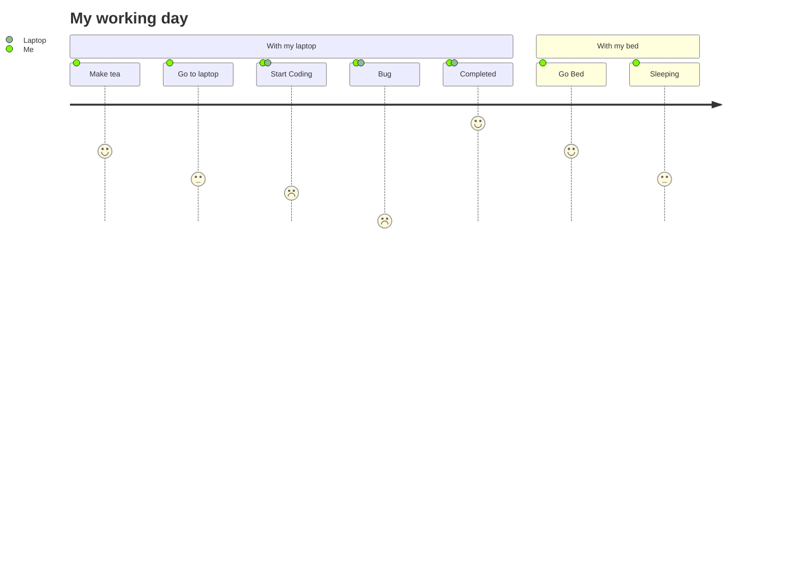

Hi 👋 Welcome to trustlelab's Profile!

## Software Engineer 

- Python, Go, Javascript, Typescript, PHP, Rust
- Node.js, Django, Flask, FastAPI, React, Next, Vue
- Docker, Kuberctl, Ubuntu, Debian, CentOs, Hosting, Terraform, Pulumi
- AI Agent, NLP, LLM, OpenAI, Claude, Llama, VectorDB, Langchain, LangGraph, llamaindex, Ollama
- Data Mining, Databricks, Microsoft Fabric, Scraping, Automation, Analytics, Data processing, Proxy, Bypassing
  

📫 How to reach me: 
Email : trustlelab@gmail.com

